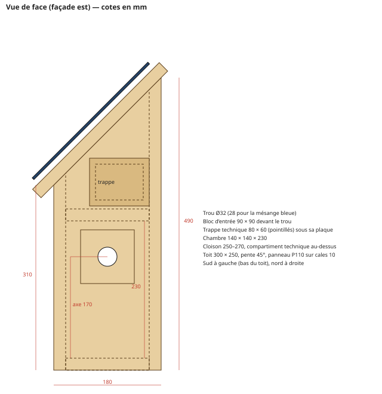

# Nichoir vidéo solaire

Nichoir en bois pour mésanges, autonome au solaire : détection des entrées et sorties, clip vidéo avec son, envoi en Wi-Fi vers une galerie sur Unraid.

État : conception. Plans du nichoir prêts ([docs/plans](docs/plans/README.md)) ; aucun firmware, aucun essai matériel.

## Matériel retenu

| Élément | Choix | Remarque |
|---|---|---|
| Carte et caméra | [Gotronic 39234](https://www.gotronic.fr/art-carte-xiao-esp32s3-sen--soud--47620.htm) : XIAO ESP32-S3 Sense 102010635, connecteurs soudés, caméra **OV3660** (2048 × 1536), micro, lecteur microSD (32 Go maxi), antenne | 17,90 € TTC, 8 en stock le 23/11/2026. Consommation annoncée : 138 mA en vidéo, 341 mA en prise de photo |
| Éclairage | LED IR 940 nm, allumées seulement pendant la capture, commandées par transistor depuis le 5 V | Référence, nombre et courant à choisir et mesurer |
| Détection | Barrière IR au trou d'envol + photo toutes les 10 min en journée | PIR intérieur optionnel |
| Panneau | Voltaic P110, 9,54 W, 223 × 274 mm | Sur le toit à 45° orienté sud |
| Batterie | Voltaic V75, 72,36 Wh, sortie USB Always On | 89 USD chez le fabricant ; coffret séparé et ombragé, charge entre 0 et 45 °C |

**À vérifier dès réception : la caméra voit-elle l'infrarouge ?** Si l'OV3660 du kit a un filtre IR-cut, les LED 940 nm l'éclaireront mal. Test simple : filmer la LED d'une télécommande de télé pendant un appui. Si la caméra ne la voit pas, il faudra un module caméra NoIR (sans filtre) compatible avec le connecteur de la Sense, ou renoncer aux images dans le noir.

## Fonctionnement prévu

- **Capture :** clip 720p de 20 s sur microSD (AVI), plus une photo pleine définition (3 Mpx) au début de chaque événement.
- **Son :** enregistré pendant chaque clip par le micro de la carte, dans le même fichier (mono, 16 kHz, environ 640 ko par clip). Aigus coupés au-dessus de 8 kHz. Jamais d'enregistrement continu.
- **Envoi :** en Wi-Fi vers Unraid après chaque clip. Le clip reste sur la SD tant qu'Unraid n'a pas confirmé l'avoir enregistré ([règles de livraison](docs/decision-v2.md)).
- **Galerie sur Unraid :** clips convertis en MP4 avec son, carnet de nidification (construction du nid, ponte, éclosion, envol), capteurs Home Assistant (batterie, dernière visite, nombre de visites). Pas de flux en direct ni de Frigate.
- **Télémétrie :** tension batterie, signal Wi-Fi et température envoyés avec chaque clip ; mode survie quand la batterie baisse (moins de clips, puis photos seules). Réglages Wi-Fi et serveur par un portail de configuration, hors firmware et hors Git.
- **Énergie :** au Havre en décembre, le P110 incliné à 45° produit environ 8 Wh/j en moyenne ([données PVGIS](docs/pvgis-le-havre-inclinaisons.csv)). Consommation réelle à mesurer.

## Le nichoir en bois

Plans, débit et montage : **[docs/plans](docs/plans/README.md)**.

- Chambre 140 × 140 × 230 mm, trou Ø32 (28 pour réserver aux mésanges bleues), selon le tableau LPO.
- Planche de 20 mm, environ 2 m de long pour la caisse, plus le toit de 300 × 250.
- Compartiment technique au-dessus de la chambre, sous le toit à 45° qui porte le panneau.
- Côté sud pivotant pour le nettoyage d'automne.

Pièces imprimées éventuelles (supports, coffret) : PETG ou ABS plutôt que PLA. Silicone autour des passages, vernis de protection sur les cartes, petit orifice bas pour évacuer l'humidité.

La faune passe avant les images : chambre ombragée aux heures chaudes, aucun perchoir, aucun câble ni pointe dans la chambre. **Aucune intervention sur un nichoir occupé** ; en cas de panne, la vidéo reste arrêtée jusqu'à l'automne.

## Prochaines étapes

1. Commander la carte et vérifier la vision infrarouge (test de la télécommande).
2. Essai dans un carton fermé percé d'un trou de 32 mm, avec les LED IR : image, son, netteté à 15–20 cm.
3. Mesurer au wattmètre USB la consommation par clip et en veille ; comparer veille et coupure d'alimentation entre deux événements.
4. Montage à blanc du nichoir, puis passages de la caméra, des LED et du micro dans la cloison.
5. Écrire le firmware (base d'étude : `ESP32-CAM_MJPEG2SD`) et la galerie Unraid.

## Options écartées

| Option | Raison |
|---|---|
| Raspberry Pi, flux en direct, Frigate | Aucun câble possible jusqu'au nichoir ; un Raspberry Pi consomme trop pour le solaire |
| Panneau 2 W | Trop faible en hiver |
| Pack 18650 fait maison, power bank quelconque | Sécurité ; la plupart des power banks s'éteignent à faible consommation |
| Vidéo 1080p ou pleine définition | Fichiers trop lourds à envoyer en Wi-Fi |
| PIR seul | Un oiseau qui couve bouge peu |
| Écoute audio continue | Trop d'énergie |

## Documentation

- [Plans du nichoir](docs/plans/README.md)
- [Recherches V3 : éclairage, toit, batterie, PVGIS](docs/recherches-v3.md)
- [Inspirations BirdWatch, Naturebytes, Printables et audio](docs/inspirations-audio.md)
- [Comparatif de 14 projets ESP32 + caméra + PIR](docs/comparatif-pir-ov5640.md)
- [Décision V2 : règles de livraison des clips](docs/decision-v2.md)
- [Archive V1](docs/archive/v1/README-v1.md)

Contrôles : `python -m unittest discover -s tests -v`, `python tools/plan_nichoir.py --check` et `python tools/verifier_dossier.py`.
