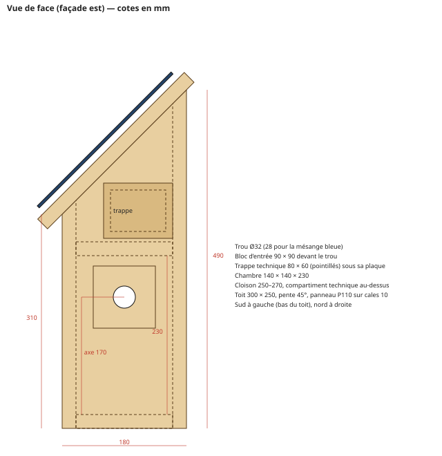
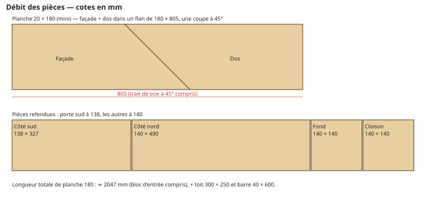
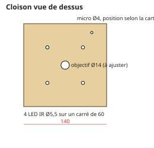
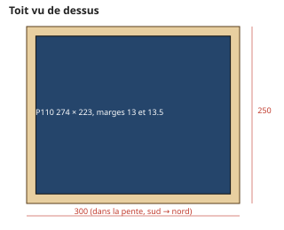

# Plans du nichoir en bois

[Accueil](../../README.md) · Générateur : [`tools/plan_nichoir.py`](../../tools/plan_nichoir.py)

Plan propre à ce projet : nichoir « boîte à lettres » de la LPO, agrandi pour loger l'électronique au-dessus de la chambre et porter le panneau solaire sur un toit à 45°. Cotes en mm. **Non encore construit** : faire un montage à blanc avant de visser.

Référence : les dimensions de la chambre et du trou suivent le [tableau de la LPO](https://www.lpo.fr/la-lpo-en-actions/mobilisation-citoyenne/refuges-lpo/tutoriels/nichoirs-pour-passereaux) et son [tuto PDF 2025](https://www.lpo.fr/media/read/47921/file/Nichoirs%20pour%20passereraux-mis%20%C3%A0%20jour%202025.pdf) (plans © LPO, consultables sur leur site, non recopiés ici). Pour un nichoir simple sans électronique, leur plan « boîte à lettres » suffit.

| Critère LPO | Ce plan |
|---|---|
| Fond intérieur ≥ 12 × 12 cm ; 14 × 14 cm pour la charbonnière | 140 × 140 |
| Hauteur intérieure 23 cm | 230 |
| Trou : 32 mm charbonnière, 26–28 mm mésange bleue | 32 (ou 28 pour réserver le nichoir aux petites mésanges) |
| Bas du trou ≥ 15 cm au-dessus du fond ; trou à 17 cm | axe à 170, bas du trou à 154 |
| Bois plein 2 cm, brut à l'intérieur, pas d'aggloméré | planche 20 mm, mélèze, pin ou chêne |
| 2 trous de 5 mm dans le fond | 4 trous Ø5 |
| Une partie amovible pour le nettoyage | côté sud pivotant |
| Trou à l'est ou au sud-est, jamais face aux vents dominants | façade est ; toit en pente vers le sud |

## Dessins





 

## Liste des pièces

| Pièce | Qté | Cotes finies (mm) | Remarque |
|---|---:|---|---|
| Façade (est) | 1 | 180 de large, 310 côté sud → 490 côté nord | trapèze, trou Ø32 centré, axe à 190 du bas |
| Dos (ouest) | 1 | même trapèze | trappe technique 100 × 60, passe-câble et aération |
| Côté sud (porte) | 1 | 138 × 327, biseau 45° en tête (307 face extérieure) | 1 mm de jeu de chaque côté, raccourci de 3 mm pour pivoter sous le toit |
| Côté nord | 1 | 140 × 490, biseau 45° en tête (470 face intérieure) | |
| Fond | 1 | 140 × 140 | 4 trous Ø5 près des angles |
| Cloison | 1 | 140 × 140 | dessous à 250 du bas : caméra, LED IR, micro |
| Toit | 1 | 300 dans la pente × 250 | planche large ou deux planches collées |
| Bloc d'entrée | 1 | 90 × 90 | trou Ø32 aligné, logement de la barrière IR |
| Barre de fixation | 1 | 40 × 600 | vissée sur le dos |

Débit : une planche de 20 mm d'au moins 180 de large et environ **2,05 m** de long (traits de scie et équerrage compris), plus le toit et la barre. Façade et dos sortent d'un seul flan de 180 × 805 coupé en diagonale à 45°. Côtés, fond et cloison sont refendus à 140.

## Montage

1. **Débit.** Couper le flan 180 × 805 en diagonale (45°) : on obtient façade et dos. Refendre à 140 le côté nord, le fond et la cloison, à 138 la porte sud. Biseauter à 45° le haut des deux côtés.
2. **Trou d'envol.** Scie cloche Ø32 dans la façade : centré, axe à 190 du bas. Percer le bloc d'entrée au même diamètre. Rainures horizontales à l'intérieur sous le trou si le bois est lisse.
3. **Fond.** 4 trous Ø5. Laisser le bois brut à l'intérieur.
4. **Caisse.** Visser le côté nord, le fond (de 0 à 20) et la cloison (dessous à 250, cale de 230 posée sur le fond) entre façade et dos. Vis inox 4 × 40, avant-trous Ø3. Le fond et la cloison ne sont **pas** vissés au côté sud.
5. **Porte sud.** Deux vis pivots 4 × 40 à travers façade et dos, dans le chant de la porte, **à 290 du bas et à 10 du bord sud** (milieu de l'épaisseur) : au-dessus de la cloison, sous le toit. Une rondelle entre porte et façade, une entre porte et dos. En bas, un crochet ou une vis de blocage. Vérifier que la porte bascule sans toucher le toit. Un joint mousse ou une brosse ferme la fente de 3 mm sous le toit (insectes).
6. **Trappe technique.** Découper dans le dos une trappe de 100 × 60 (de 40 à 140 depuis le bord sud, de 280 à 340 du bas), avant l'assemblage. Elle se referme par deux vis avec un joint, et une tasselette intérieure lui sert d'appui. C'est l'accès à l'électronique et à la carte SD, sans démonter le toit ni le panneau.
7. **Électronique** (voir [README](../../README.md)). Percer la cloison après réception de la carte : passage d'objectif, 4 LED IR, trou micro au droit du micro de la carte. La carte repose sur la cloison, objectif vers le bas. **Laisser libres les 40 premiers millimètres côté sud du compartiment** : le haut de la porte y rentre quand elle s'ouvre.
8. **Passages.** Dos, dans le compartiment technique (vers 300 du bas) : passe-câble Ø10 avec presse-étoupe vers le coffret de la batterie, boucle d'égouttement. Façade et dos : deux trous d'aération Ø8 grillagés, en haut du compartiment, sous le débord du toit. Câble de la barrière IR : dans une baguette sur la façade, jusqu'au compartiment technique. Aucun câble dans la chambre.
9. **Toit.** Vissé sur façade, dos et côté nord, jamais sur la porte, **avant** la pose du panneau : ses vis tombent sous l'emprise du panneau, le toit reste donc fixe. Couverture étanche (EPDM ou tôle). Panneau P110 sur une platine démontable, elle-même sur cales de 10, marges de 13 mm.
10. **Pose.** Barre de fixation sur le dos. Nichoir légèrement penché vers l'avant (LPO), à 2 m au moins, solidement fixé, cales entre tronc et fil de fixation. Huile de lin facultative (LPO), à l'extérieur uniquement (choix du projet).

La porte sud ouvre la chambre ; la trappe du dos ouvre le compartiment technique. **Ni l'une ni l'autre pendant la nidification** : nettoyage et maintenance en automne, nichoir vide.

## À vérifier au montage à blanc

- Hauteur totale : environ 515 mm avec le toit et le panneau. Prise au vent et fixation à adapter au support.
- Le champ de la caméra à 15–20 cm du nid : l'objectif de l'OV3660 doit couvrir les 140 × 140 du fond ; mise au point à régler.
- La porte pivote sans frotter ; le loquet ne laisse pas de jour.
- Étanchéité de la couverture et des passages ; ventilation sans courant d'air sur le nid.

## Régénérer les plans

```sh
python tools/plan_nichoir.py          # contrôles + régénération des SVG
python tools/plan_nichoir.py --check  # contrôle seul (utilisé par les tests)
```

Les paramètres (épaisseur, trou, pente, toit, panneau) sont en tête du script. Le script vérifie les critères LPO, la place du compartiment technique et le panneau sur le toit.
